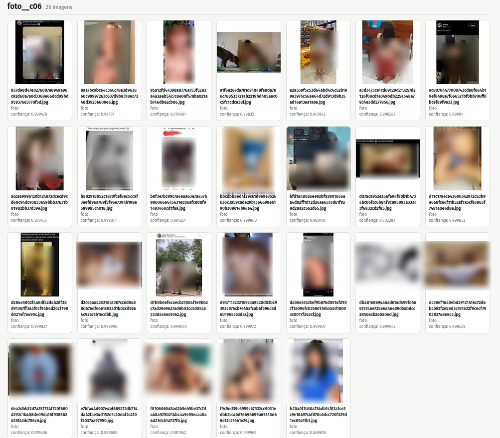
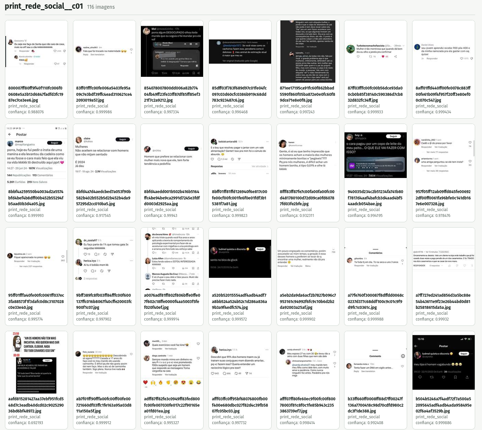
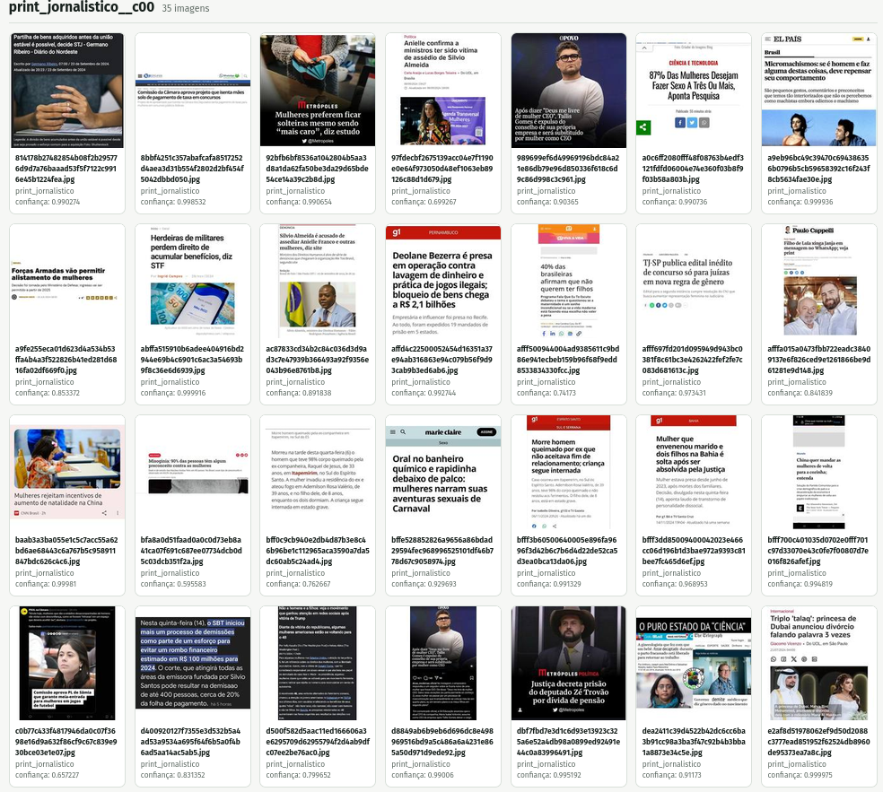
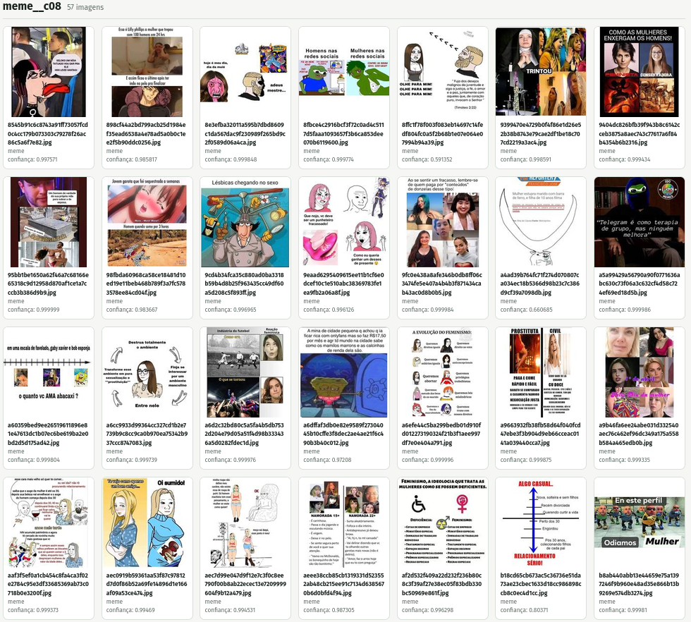

## Acesse a apresentação online {.center}

{width=320px}

[ericbrasil.com.br/pgcult](https://ericbrasil.com.br/pgcult/)

---

## Nota sobre o uso de IA generativa {.center}

Esta apresentação foi estruturada, redigida e formatada com assistência do Hermes Agent, utilizando o modelo de linguagem `gpt-5.6-luna` no dia 10 de novembro de 2026. 

A supervisão, as escolhas editoriais, a análise, a argumentação e a responsabilidade intelectual são de Eric Brasil.

---

## Ponto de partida {.center}

A IA generativa não é apenas uma nova ferramenta digital.

Ela desloca:

- as operações da pesquisa;
- a relação entre fontes, dados e interpretação;
- a divisão do trabalho intelectual;
- as condições materiais de produção do conhecimento.

---

## "Desculpe, Dave. Não posso fazer isso." {.center}

---

## Nem tínhamos discutido o giro digital e sofremos um capotamento pela tal da IA generativa.  {.center}

> O giro digital ampliou a capacidade de localizar, organizar e relacionar vestígios.
>
> O deslocamento generativo acrescenta sistemas capazes de **produzir operações intermediárias de pesquisa**.

---

## A desconfiança com o digital  {.center}

Por que o digital ainda produz desconfiança nas humanidades?

- retorno aparente ao positivismo e à quantificação;
- vieses, racismo algorítmico e reprodução de desigualdades;
- sistemas opacos (*black boxes*);
- confusão entre volume de dados e qualidade da evidência.

---

## O problema não é usar dados digitais {.center}

O problema é tratar escala e visualizações como sinônimo de conhecimento.

- dados são produzidos por instituições e infraestruturas;
- bases são recortadas, indexadas e hierarquizadas;
- modelos carregam regularidades e ausências dos seus dados;
- toda saída exige crítica de fonte, contexto e método.

---

## Do instrumento ao ambiente epistêmico  {.center}

No giro digital, a ferramenta podia ser pensada como extensão do método.

Com a IA generativa, o sistema passa a:

- resumir e classificar;
- recuperar trechos e relações;
- propor hipóteses;
- escrever código e executar tarefas;
- coordenar uma sequência de operações.

---

## Do instrumento ao ambiente epistêmico  {.center}

A questão deixa de ser apenas “qual ferramenta usar?”.

Passa a ser: **que ambiente de produção do conhecimento estamos construindo?**

---

## A virada generativa {.center}

* Todo mundo já conversou com um chatbot? 
* Quais vocês usam? ChatGPT, Claude, Gemini, DeepSeek?
* **Chatbots são apenas a interface mais visível.**
* **Recebiam texto, devolviam texto. Hoje também estão se "agentificando". Vocês notaram?**

---

## A virada generativa {.center}

O deslocamento relevante ocorre quando LLMs deixam de ser usados somente para conversar e passam a integrar:

- fluxos de trabalho;
- bases documentais;
- APIs e ferramentas;
- rotinas de análise e verificação.

---

## Hermenêutica digital aumentada {.center}

- infraestrutura de armazenamento, indexação e recuperação;
- corpus digital;
- agentes de IA elaborados com *skills* de pesquisa;
- modelos de linguagem especializados;
- protocolos de validação e auditoria;
- registro das decisões e dos limites.

---

## Hermenêutica digital aumentada {.center}

>O ganho não está em delegar a interpretação, ou em acelerar o processo apenas.
>
>Está em ampliar o espaço de perguntas que o pesquisador consegue formular e testar.

---

## Exemplo 1 - RAG: aproximar resposta e fonte {.center}

*Retrieval-Augmented Generation* combina um modelo de linguagem com uma base documental.

1. documentos são carregados e indexados;
2. a pergunta recupera trechos relevantes;
3. o modelo produz uma resposta apoiada nesses trechos;
4. o pesquisador verifica fonte, contexto e ausência.

---

## Exemplo 2 - Agentes de IA: sistema integrado de pesquisa {.center}

>**Um agente combina modelos de linguagem, ferramentas ou habilidades específicas, memória  de curto prazo (contexto), memória de longo prazo (base documental e/ou base de sessões), regras e protocolos de ação, auditoria e registro de decisões.**

---

## O que um agente pode fazer? {.center}

- buscar na web e consultar APIs;
- ler e transformar arquivos;
- executar código;
- repetir etapas com critérios definidos;
- produzir registros intermediários para auditoria.
- receber guardrails e protocolos de ação.
- receber instruções teóricas e metodológicas.

---

## Agentes: autonomia? {.center}

---

## O que muda para as humanidades? {.center}

* **A pesquisa pode passar de uma sequência manual de tarefas para um sistema de operações parcialmente automatizadas.**
* Ampliação do espaço de perguntas e hipóteses que podem ser testadas.
* Velocidade, volume e complexidade dos dados pode ser superada com sistemas de recuperação, classificação e análise.

---

## Novas demandas para as humanidades? {.center}

- **INTERDISCIPLINARIDADE** = urgência;
- conhecimento técnico especializado;
- transparência, versionamento, auditoria;
- distinguir sugestão, evidência e interpretação;
- infraestrutura de armazenamento e processamento;
- APIs abertas e documentadas;
- financiamento continuado;

---

## LABHDUFBA: desinformação e discursos de ódio nas redes sociais {.center}

- corpus de grande escala, coletado em tempo real;
- dados de telegram, YouTube, Instagram, Whatsapp, Discord, Roblox;
- mais de 70 milhões de mensagens;
- cerca de 4 milhões de imagens;
- cerca de 1 milhão de vídeos;
- cerca de 30 TB de dados.

---

## A escala e a velocidade de produção de dados torna impossível uma leitura exclusivamente manual. {.center}

---

## Clusterização de imagens {.center}

::: {.columns}
::: {.column width="25%"}

:::
::: {.column width="25%"}

:::
::: {.column width="25%"}

:::
::: {.column width="25%"}

:::
:::

---

## Infraestrutura também é política do conhecimento {.center}

Uma agenda mínima inclui:

- servidores públicos e armazenamento federado;
- APIs abertas para pesquisa;
- créditos de uso de modelos;
- plataformas auditáveis de preservação;
- formação em História Digital e métodos computacionais.
- debates sobre impactos ambientais, privacidade e segurança.

---

## Conclusão {.center}

O deslocamento generativo reconfigura a pesquisa em três níveis:

1. **Operacional** — automatiza tarefas e conecta ferramentas.
2. **Metodológico** — exige novos protocolos de validação e auditoria.
3. **Epistêmico** — altera a relação entre evidência, interpretação e agência.

---

## Obrigado {.center}

::: {.columns}
::: {.column width="50%"}
**Eric Brasil**  

- [ericbrasil.com.br](https://ericbrasil.com.br)  
- [profericbrasil@unilab.edu.br](mailto:profericbrasil@unilab.edu.br)
- [profericbrasil@gmail.com](mailto:profericbrasil@gmail.com)
- [LABHDUFBA](https://labhdufba.com.br)
:::

::: {.column width="50%"}

